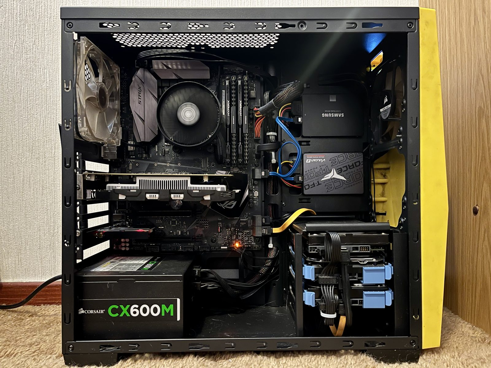
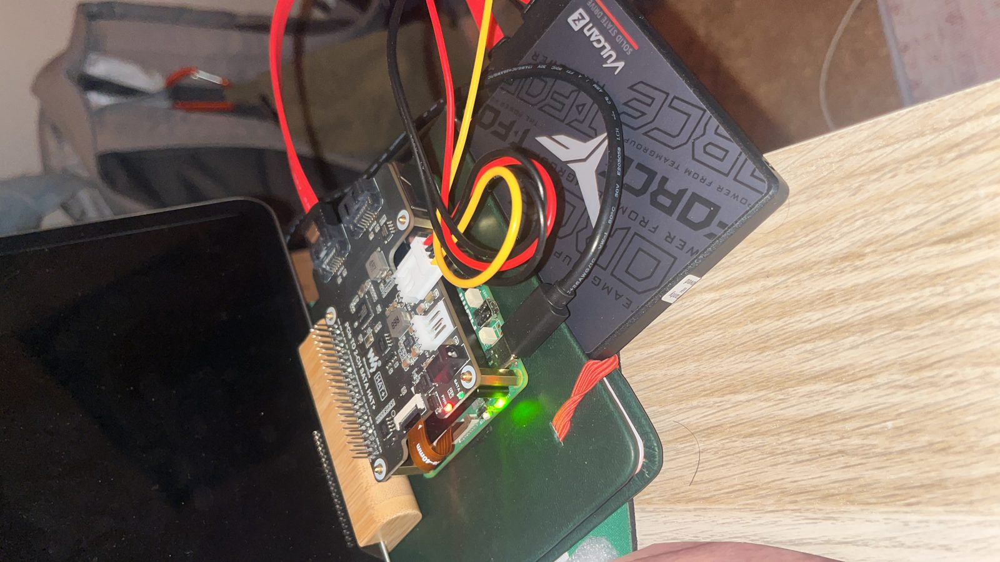
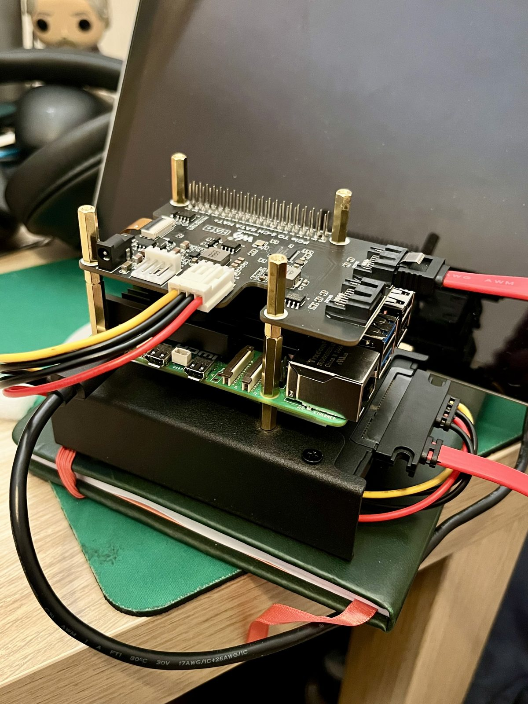
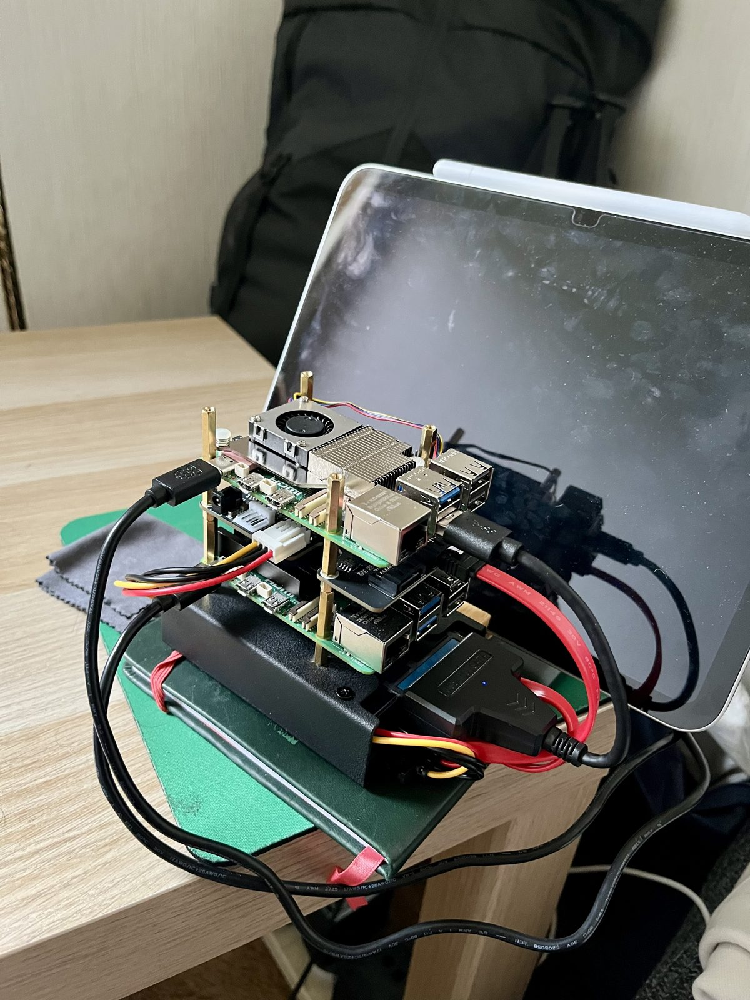
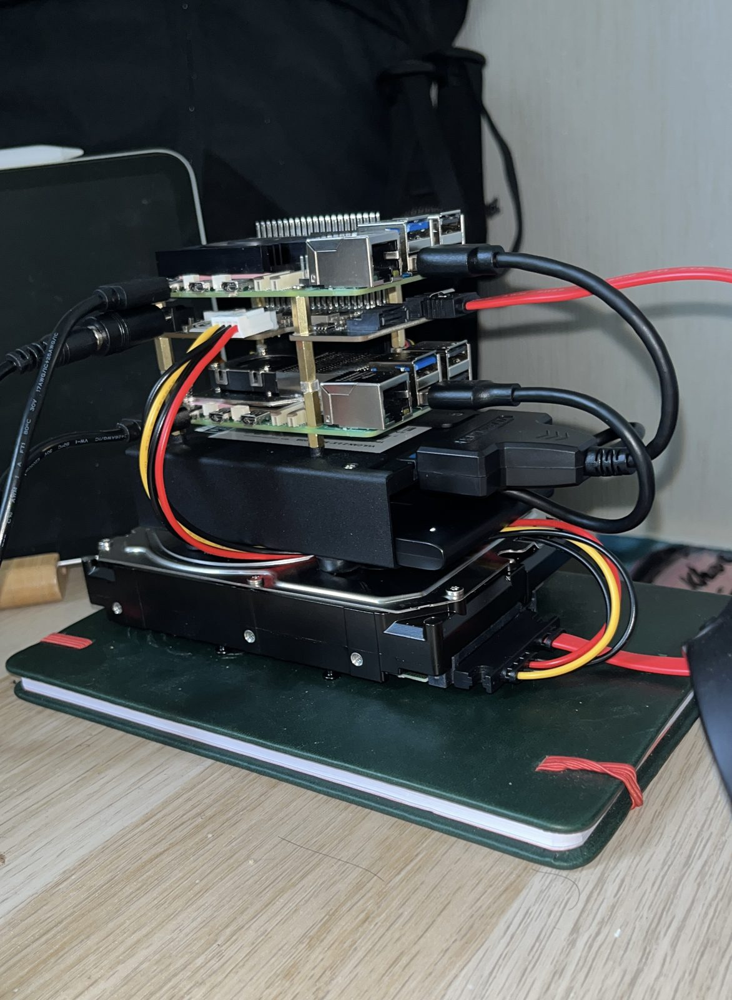
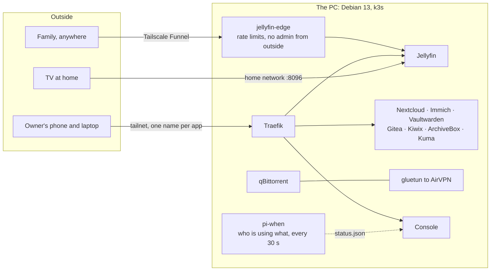
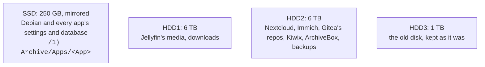
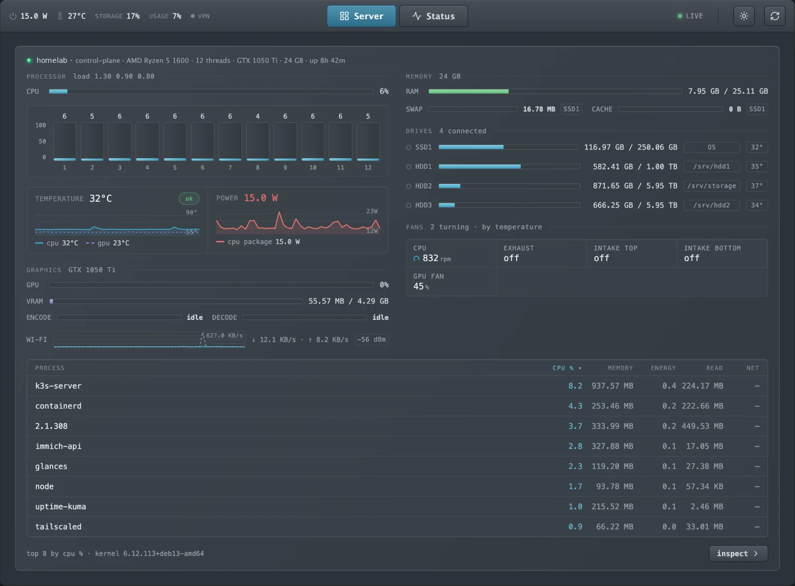
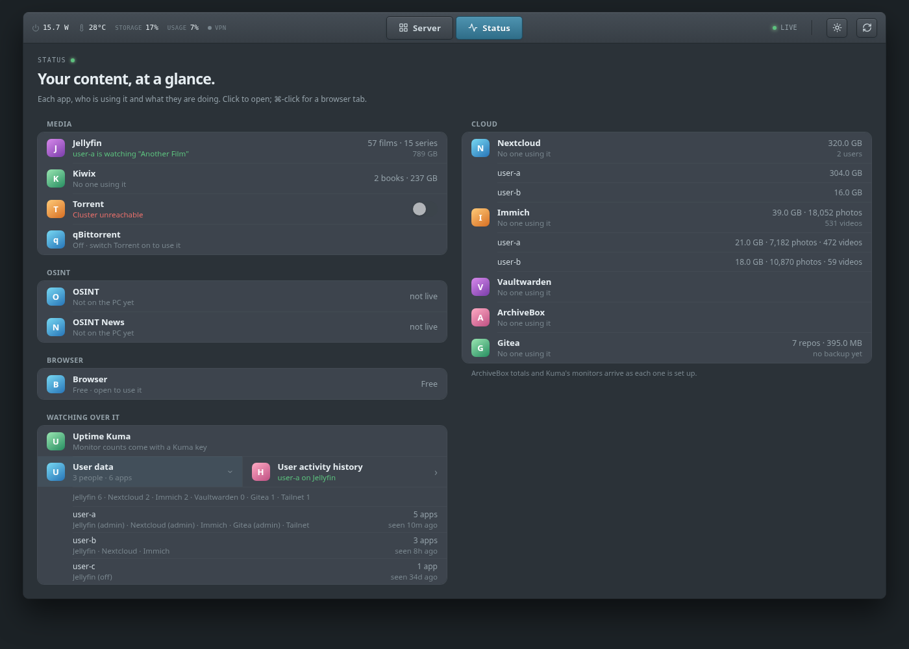

# homelab

A family's apps on one headless PC in a bedroom: films, photos, files,
passwords, Git, a local AI, an offline Wikipedia. It runs on Debian 13 and k3s
and is reached over Tailscale. It started as one Raspberry Pi and a loose SSD.

<p align="center">
  
</p>

> **This is a public snapshot.** The live setup is in a private repo, private
> because it is wired to one home: its open issues, its history and the notes
> on the people who use it. This copy is cleaned of all of that, tested (see
> [Tested](#tested)) and updated **by hand, now and then**, not on every
> change. Snapshot of **25 October 2026**.

---

## The journey

### 1. One Pi, one SSD, one mission



A Raspberry Pi with a SATA HAT and a loose SSD on top as a test subject. It ran
OSINT tooling around the clock from day one: no bracket, no second board, just
a Pi and a drive proving the idea worked.

### 2. A bracket: making it real



An SSD bracket to hold the drive under the HAT. Still one Pi, but now something
that could run for months without a drive sliding off the desk.

### 3. A second Pi



Two boards stacked on standoffs and the start of real homelab work: one for
OSINT, one clean slate. The second became a k3s server.

### 4. Two Pis, two SSDs, one HDD: 6 TB



Two Pis, two SSDs and a 3.5" hard drive on the SATA HAT. Jellyfin, Nextcloud,
Immich and a password vault for the family, the OSINT stack still running, and
6 TB of storage. Here the Pis ran out: USB-attached disks dropping off,
transcoding a film was beyond them, and one board going quiet for 16 hours
took everything with it.

### 5. One PC


A desktop replaced both boards: Ryzen 5 1600, 24 GB of RAM and a GTX 1050 Ti for
transcoding and a small local AI. Two SSDs (the app databases, mirrored) and
three hard drives (6 + 6 + 1 TB) for media, photos and files. No screen and no
cable: it sits on Wi-Fi and is run entirely over SSH. Everything the second Pi
ran under k3s moved across; the Pis are retired.

The whole story, step by step with what went wrong:
[`docs/build-log.md`](docs/build-log.md). The machine as built:
[`docs/pc.md`](docs/pc.md).

---

## What runs on it

| App | What for | Reached |
|---|---|---|
| Jellyfin | films and series, transcoded on the GPU | tailnet, home network (TV), and the internet through Tailscale Funnel behind a guard |
| Nextcloud | files, each person's own | tailnet |
| Immich | photo backup from phones | tailnet |
| Vaultwarden | passwords | tailnet |
| Gitea | self-hosted Git | tailnet |
| Kiwix | Wikipedia and more, offline | tailnet |
| ArchiveBox | saved copies of web pages | tailnet |
| qBittorrent | downloads, every packet through a VPN (gluetun + AirVPN), off by default | tailnet |
| Uptime Kuma | watches all of the above, alerts on Discord | tailnet |
| Local AI | a small model on the GPU, answers on Discord | Discord |
| **Console** | this repo's own dashboard: the PC, its files, who is using what | tailnet |



### Where things are kept



The split is by how a file is read: anything read at random (settings,
databases, caches) on the SSD, anything you would call a file (films, photos,
archives) on a hard drive. A database on a spinning disk makes the whole app
feel slow. Each drive is a folder in the PC's Samba share, named for what it is.
More: [`docs/storage.md`](docs/storage.md).

---

## The console





A dashboard written for this box: a `node:http` server and a Preact client,
one runtime dependency. Its tabs:

- **Server** (the real PC, above): CPU per thread, memory, every drive, the GPU,
  temperatures, power draw, the fans (which it can also set) and the busiest
  processes.
- **Status** (demo data, below it): each app and who is on it right now, the library sizes, the
  torrent and VPN switch, and the **Users** line: *User data* (how many people,
  who has an account in which app) and *User activity history* (who used what,
  and when, over two days).

Sign-in is a passkey (Face ID / Touch ID) or an admin password. The refresh
button makes the PC scan who is using what immediately.
Design: [`docs/dashboard.md`](docs/dashboard.md).

### Try it without a server

Node 22 and pnpm (Corepack) are enough. It runs with demo data:

```bash
cd dashboard
corepack pnpm install
corepack pnpm build
CONSOLE_PASSWORD=demo STATUS_FILE=demo/status.json APPS_CONFIG=demo/apps.json \
  CONSOLE_STATE_DIR=/tmp/console node dist/server.js
```

Open <http://localhost:8080>, sign in with `demo` and go to **Status**. The
Server tab stays empty without Tailscale and an agent; that is expected.

---

## What is in here

| | |
|---|---|
| [`dashboard/`](dashboard) | the console |
| [`agent/`](agent) | the per-machine agent: Glances plus a small shim for sensors, fans and files |
| [`k8s/`](k8s) | the manifests: one file per app |
| [`deploy/`](deploy) | install scripts run on the PC: apps, disks, the SSD mirror, firewall, SSH, backups, monitoring, `pi-when` |
| [`Makefile`](Makefile) | the deploy commands; `make` on its own lists them |
| [`docs/`](docs) | [running it](docs/operations.md), [the PC](docs/pc.md), [storage](docs/storage.md), [deploying](docs/deploy.md), [the console](docs/dashboard.md), [the build log](docs/build-log.md) |

Not in here: the private repo's history and issues.

## Using it on your own machine

It is one person's setup, written down carefully, not an installer. Read
[`docs/operations.md`](docs/operations.md) and [`docs/deploy.md`](docs/deploy.md)
first. The parts to change:

| What | Where |
|---|---|
| The machine's name (`homelab`) | `Makefile` (`NODE`, `DASH_NODE`, ...), `dashboard/server/apps.json` |
| Your tailnet | every `<tailnet>.ts.net`, mostly `dashboard/server/apps.json` and `Makefile` |
| Where settings and data live | `APPS_DIR`, `DATA_DIR`, `POOL_DIR` on the `make` targets; `/1) Archive/Apps` and `/srv/hdd2` are this box's |
| Secrets | never in the repo: the scripts ask for them or read `/etc/pi-bot/env` and k8s Secrets |
| The VPN | `make torrent` asks for AirVPN's WireGuard keys |

Then, from a laptop with SSH to the machine:

```bash
make bootstrap NODE=<your-machine>   # deploy key + checkout on the machine
make agents
make dashboard-k8s
make                                 # lists the rest: media, cloud, photos, vault, ...
```

## Tested

For this snapshot, on 25 October 2026:

- The console: a clean `pnpm install`, `tsc --noEmit` and a build, then run
  with the demo data above and checked in a browser.
- All 53 shell scripts pass `bash -n`; every Python file parses.
- All 14 manifests pass `kubectl apply --dry-run=client`.
- Scanned for secrets with gitleaks: none.
- The same code runs the real PC today.

Not tested: a full install on a fresh machine. That needs a second, empty PC.

## The private repo

Everything here comes from a private repo that holds the live setup: open
issues, the full history and notes about the people who use it. It stays
private for their sake. This copy shows what has been built; it is refreshed by
hand when there is something worth showing.
